

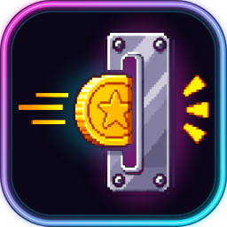

# ONE MORE COIN
#### LIBRARY

### Todos tus juegos. Una sola biblioteca. Cero excusas para no jugar.

**Steam · Epic Games · GOG · EA · Ubisoft · Battle.net · Riot · Amazon · itch.io · Rockstar · Xbox · Humble · Legacy Games**

<a href="https://jesusjacky.github.io/OneMoreCoin-descargas/">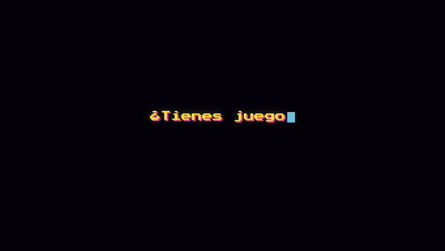</a>

**[▶ Ver el vídeo completo (2 min)](https://jesusjacky.github.io/OneMoreCoin-descargas/)** Música: «It Takes A Hero», de Zane Little Music (CC0)

> [!NOTE]
> 🪙 **Insert Coin ahora se llama One More Coin.** Es **la misma app**, con las mismas funciones. Si ya la tenías, se actualiza
> sola desde su menú 🪙 y conserva tu biblioteca, tus niveles, tus críticas, tus deseados y tus ajustes. El nombre cambia porque
> «Insert Coin» ya lo tenía registrado otra empresa para software y videojuegos.

---

> **En una frase:** One More Coin es un programa **gratuito** para Windows que junta en una sola pantalla **todos los juegos que ya tienes**
> en Steam, Epic, GOG, EA, Ubisoft, Battle.net y demás tiendas, para que no tengas que ir abriéndolas una por una.

## 🛡️ ¿Es de fiar?

**No te pide nada:** ni usuario, ni contraseña, ni iniciar sesión. Lee la lista de juegos que tus launchers ya guardan en tu PC, como quien
lee los títulos de una estantería, y para jugar le pide al launcher que abra el juego. ¿Cómo funciona por dentro? Está explicado sin
tecnicismos en las [preguntas frecuentes](#-preguntas-frecuentes).

| ✅ Lo que hace | 🚫 Lo que no hace |
|---|---|
| Mira la lista de juegos que tus tiendas ya guardan en tu PC | No toca tus tiendas, tus juegos ni tus partidas: solo mira |
| Busca la portada, el año y la nota de cada juego **por su nombre** | No se mete en tus juegos mientras juegas (nada que pueda molestar a los antitrampas) |
| Abre la **tienda oficial** cuando pulsas «Jugar» o «Instalar» | No lleva publicidad ni instala otros programas |
| Se actualiza sola desde esta misma página | No hace falta tenerlo abierto para jugar |
| Te enseña a qué juegas mirando qué programas tienes abiertos | No entra en tus cuentas: no puede comprar ni ver tus datos |

- **¿Quién está detrás?** Una persona: **JesusJacky**, que lo hace como proyecto personal. Contacto: **jesusjacky.onemorecoin@gmail.com**.
- **¿Por qué Windows avisa al instalarlo?** Porque la app aún no tiene un **certificado de firma** (cuestan dinero cada año y
  esto es gratuito). Windows avisa de **cualquier** programa nuevo sin firmar, no porque haya encontrado nada. Pulsa
  «Más información» → «Ejecutar de todos modos».
- **Está en fase beta:** funciona, pero puede tener algún fallo. Si ves uno, cuéntalo desde «💬 Sugerencias» en la propia app.

<!-- NOVEDADES:INICIO -->
## 🆕 Lo nuevo en la versión 0.4.6 · Tu año, tus logros y las noticias

- **✨ Nuevo:** 🎆 **Tu año en juegos**: un resumen espectacular de tu año, con música y un escenario de recreativa que late con ella: juegos, horas, tu juego del año con redoble y confeti, tu top, tus logros, tu título de jugador y fuegos artificiales. Solo cuenta lo de ese año y se puede guardar como imagen. En tu perfil; cambia solo cada año.
- **✨ Nuevo:** 🏆 **Logros con detalle**: en la ficha, «Ver cuáles» enseña los que tienes (con la fecha) y los que te faltan (con cómo se consiguen). Los ocultos salen tapados para no destriparte nada. De Steam y GOG Galaxy, y en castellano siempre que se pueda (aunque GOG los guarde en inglés).
- **✨ Nuevo:** ⭐ Tu **título de jugador** tiene ahora **3 niveles** (de «Aprendiz de estratega» a «Gran maestro de la estrategia»), con el porqué y lo que te falta para subir. Y el calendario de tu perfil es ahora un calendario de pared de tus días de juego.
- **⬆️ Mejora:** 🧠 El test de ánimo tiene más sensaciones para elegir (hasta tres), y todas las preguntas y avisos de la app salen ya con su estilo, nunca con las ventanas de Windows.
- **✨ Nuevo:** 📰 **Noticias** de videojuegos y de PC de portales en español, con filtros por tema y por portal, y arriba las que hablan de tus juegos. Cada noticia se abre en su web original.
- **✨ Nuevo:** 📌 **Tu progreso** en cada juego: pendiente, jugando, terminado, completado al 100 % o abandonado. Lo terminado ya no te lo recomiendan el dado ni los tests.
- **✨ Nuevo:** 🗂️ **Tus listas**: crea las que quieras («Para jugar en pareja», «Cortos para entre semana»…) desde la ficha de cada juego, y fíltralas en el panel izquierdo.
- **✨ Nuevo:** ⏱️ **Horas con One More Coin**: lo que juegas con la app abierta, en la ficha de cada juego y en tu perfil con tu top 10. También para los juegos de Epic, que no guardan horas.
- **✨ Nuevo:** 🟢 **Segundo plano**: al cerrar la ventana, la app puede seguir junto al reloj apuntando tus partidas, y abrirse al encender el PC. Te lo pregunta dentro de la app (puedes recordar tu elección) y en Ajustes eliges qué hace la ✕: preguntarte, seguir en segundo plano o cerrarse del todo.
- **✨ Nuevo:** 📅 En tu perfil, **tu semana** (horas de cada día, calendario de 12 semanas y juego del mes) y 💽 **el espacio en disco**: lo que ocupa cada juego y cuáles podrías desinstalar. Nuevo orden «Lo que más ocupa».
- **✨ Nuevo:** 📖 **Guía** en 🪙 → Guía: todo lo que hace la app, en resumen, con un botón «Llévame» para ir directo a cada cosa.

**[📜 Todas las novedades, versión a versión →](NOVEDADES.md)**
<!-- NOVEDADES:FIN -->

## 🕹️ ¿Qué es?

¿Cuántas tiendas de juegos tienes instaladas? ¿Cinco? ¿Seis? ¿Y cuántas veces has comprado en una oferta un juego **que ya tenías** en otra?

**One More Coin** lee tus launchers y junta **todos tus juegos en una sola biblioteca**, con su portada, tus horas, tus logros, el año, lo que opina la gente… Si tienes el mismo juego en varias tiendas, sale **una sola vez**. Y desde ahí mismo **lo juegas o lo instalas**.

**No es una tienda: no vende nada.** Es tu biblioteca: tus juegos siguen en su tienda de siempre, y para jugar se lo pide a ella.

<table>
<tr>
<td width="50%" valign="top">

### ▶️ Juega e instala sin abrir mil tiendas
Pulsa **Jugar** y One More Coin le pide a su tienda oficial que lo abra. ¿No está instalado? **Instalar** te lleva directo a su instalación. La tienda sigue haciendo su trabajo: comprueba que es tuyo, cuenta tus horas y guarda tus partidas.

</td>
<td width="50%">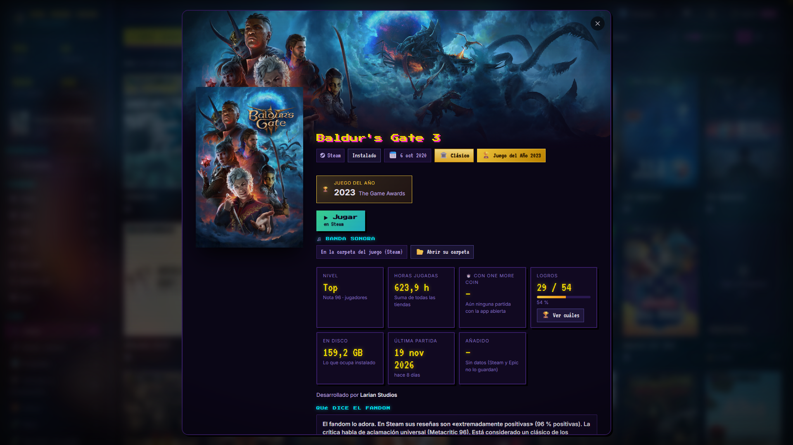</td>
</tr>
<tr>
<td width="50%">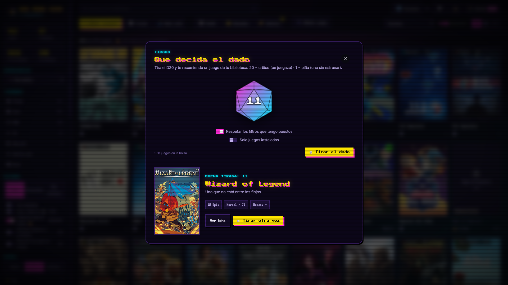</td>
<td width="50%" valign="top">

### 🎲 ¿No sabes a qué jugar? Que decida el dado
Tira un **D20** y te recomienda un juego de tu biblioteca: un **20 crítico** es un juegazo; una **pifia**, uno de esos que compraste y nunca estrenaste. O haz el **test de ánimo** y te dice qué te apetece de verdad.

</td>
</tr>
<tr>
<td width="50%" valign="top">

### 💀 Tu perfil de jugador
¿Qué juegas de verdad? Porcentaje de tus horas por tipo de juego, tus más jugados, lo último que has jugado… y **un título que te has ganado**: *«Eres un estratega»*, *«¡Wololo!»*, *«Cada muerte es un nuevo comienzo»*…

</td>
<td width="50%">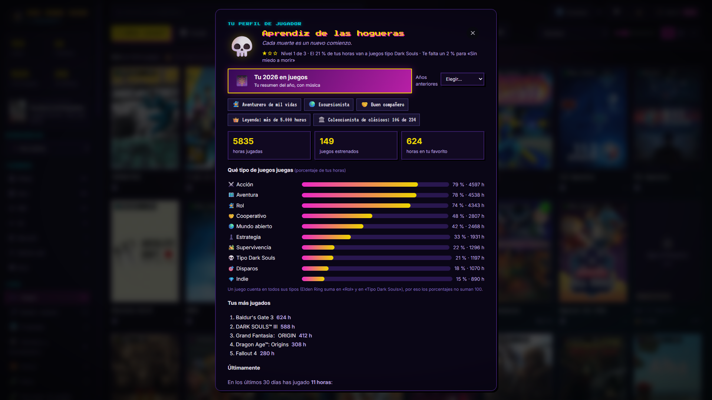</td>
</tr>
<tr>
<td width="50%">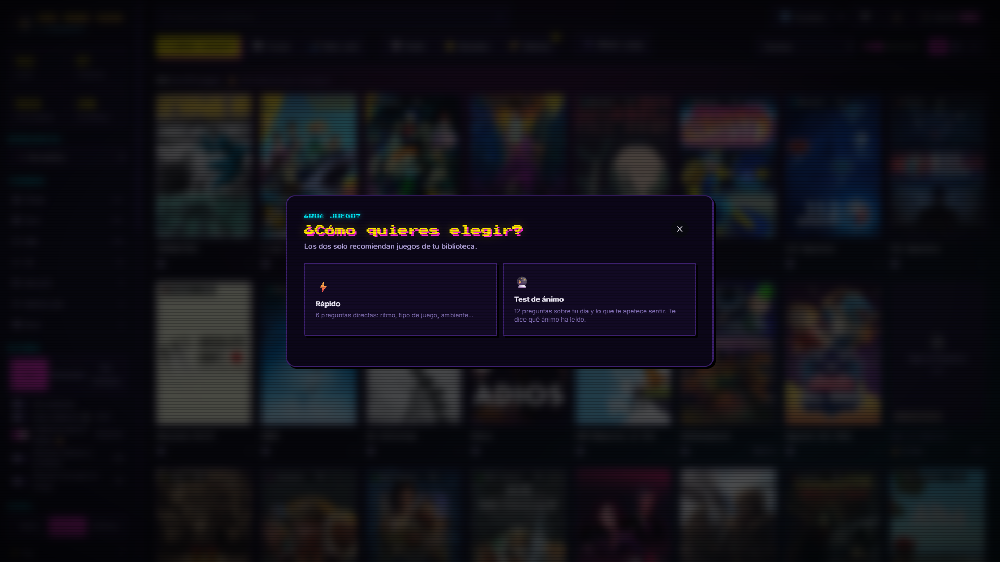</td>
<td width="50%" valign="top">

### 🧠 Test «¿Qué juego?»
Unas preguntas rápidas sobre cómo estás hoy (¿cansado?, ¿con ganas de pensar?, ¿un rato corto?) y te saca los juegos de tu biblioteca que mejor encajan.

</td>
</tr>
</table>

## 📖 Toda la información de cada juego (y su nivel)

Cada juego tiene su ficha completa, para saber de un vistazo si merece la pena:

- 📅 **Año de lanzamiento**, géneros, modos (cooperativo, online, PvP…) y **quién lo hizo** (desarrolladora y editora).
- ⭐ **Puntuaciones** de los jugadores (Steam, RAWG, GOG) y de la crítica (Metacritic), y **«Qué dice el fandom»**: un resumen de lo que opina la gente.
- 🏅 **Su nivel**: cada carta lleva su etiqueta (**Top, Juegazo, Muy bueno, Normal o Flojo**) según la nota de los jugadores, de la crítica o de las dos. Puedes filtrar por nivel o **ponerle el tuyo**.
- ✍️ **Tu propia reseña**: tu nota del 1 al 10 y lo que te ha parecido, guardado en tu PC.
- 🎬 Descripción, capturas y vídeos, tus horas, tus logros, la insignia **GOTY** si ganó el Juego del Año… y el botón para **jugar o instalar**.

## 🏛️ La colección de clásicos

Más de **230 juegos que hicieron historia**, de *Space Invaders* a *Baldur's Gate 3*. Los que tienes llevan la etiqueta 🏛️ y su
**Historia**, escrita para One More Coin: quién lo hizo, qué se atrevió a cambiar y por qué se recuerda. Si tienes un **remake** o una
**remasterización** (*Dead Space*, *Resident Evil 4*, *Age of Empires II: Definitive Edition*…), comparte la historia del original y
suma **la suya propia**. Y los que **te faltan** salen en tu biblioteca **apagados y sin portada**, con un 🔒, hasta que los consigues.
¿Cuántos tienes tú?

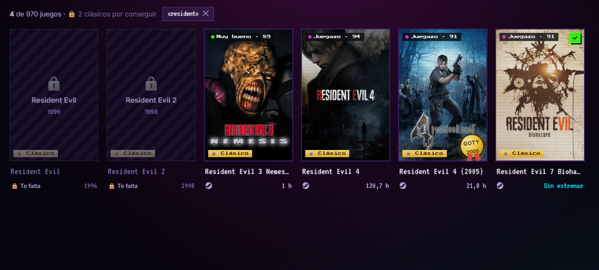
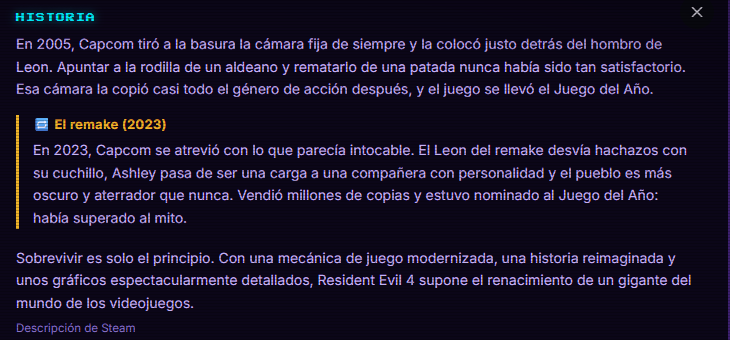

## 🛋️ Modo sofá

Coge el mando, túmbate y elige desde el sofá: **pantalla completa**, tus juegos en filas («Seguir jugando», «Instalados», «Para estrenar»…), el elegido en grande con sus capturas de fondo y **sonidos retro**. Funciona con mandos de Xbox y PlayStation (o con el teclado). Y si lo dejas quieto… *ONE MORE COIN*.

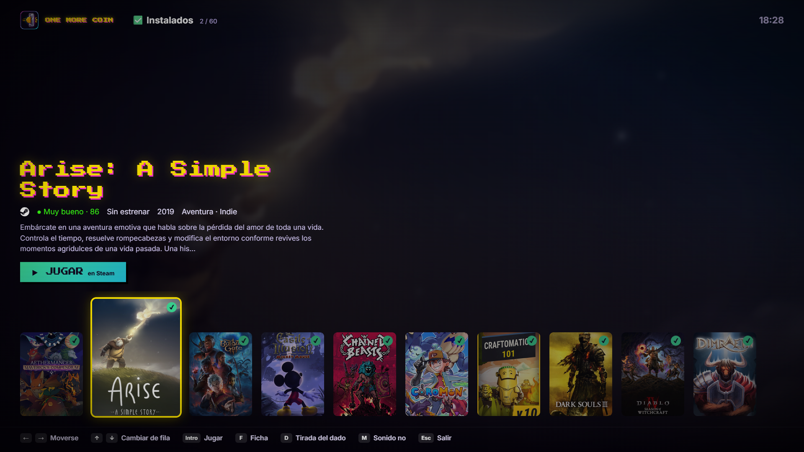

## 🎆 Tu año, tus logros y lo tuyo

- 🎆 **Tu año en juegos**: un resumen de tu año en pantallas que pasan solas, con música, como los resúmenes anuales de las apps de música: a cuántos juegos has jugado, cuántas horas, tu juego del año, tu top, tus logros y tu título de jugador. Al final, guárdalo como imagen.
- 🏆 **Logros con detalle**: los que tienes, con la fecha en que los conseguiste, y los que te faltan, con cómo se consiguen. Los ocultos salen tapados para no destriparte la historia. De Steam y GOG Galaxy.
- 📌 **Tu progreso** en cada juego (pendiente, jugando, terminado, completado al 100 % o abandonado) y 🗂️ **tus listas** («Para jugar en pareja», «Cortos para entre semana»…).
- ⏱️ **Horas con One More Coin**: lo que juegas con la app abierta, con tu top 10. Puede quedarse en **segundo plano** junto al reloj para no perderse ninguna partida (y sirve también para los juegos de Epic, que no guardan horas).
- 📅 **Tu semana** (horas de cada día, calendario y juego del mes) y 💽 **espacio en disco**: lo que ocupa cada juego y cuáles podrías desinstalar.

## 📰 Noticias de videojuegos y PC

Lo último de portales en español (3DJuegos, Vida Extra, HobbyConsolas, IGN España, Eurogamer, Xataka, HardZone…), con filtros por tema y por portal, y arriba las noticias que hablan de **juegos que tienes**. Cada noticia se abre en la web del portal: One More Coin solo las recopila.

## 🏷️ Ofertas, juegos gratis, ✨ recomendados y ⭐ deseados

Para el que no tiene ganas de mirar tienda por tienda: One More Coin **rastrea por ti los juegos gratis y las ofertas** de Steam, Epic,
GOG, Humble, Fanatical y más, **te avisa** cuando hay algo que te interesa y lo junta **todo en una ventana**, por secciones.

- 🎁 **Gratis:** los juegos que se pueden conseguir **gratis para siempre** ahora mismo, en Steam, Epic, GOG, itch.io… (y si quieres, también en móvil y consola).
- 🏷️ **Ofertas:** las mejores rebajas de **Steam, GOG, Humble, Fanatical, Epic, Green Man Gaming…**, con **filtro por tienda** y orden por descuento o precio.
  Las **rebajas destacadas de Steam**, en euros y con la cuenta atrás de cuándo terminan (las de un día o de fin de semana).
- ✨ **Para ti:** juegos **recomendados a tu medida**, a partir de **tus horas de juego** y de **los juegos que ya tienes**: los de **las sagas que ya juegas**
  y aún te faltan (¿tienes Dark Souls III? te enseña el resto de la saga), con los que están en oferta destacados, y ofertas de **los géneros a
  los que más horas dedicas**, distintas cada día. **No es intrusivo:** todo se calcula **en tu PC**; tu biblioteca y tus horas no salen de él
  (solo se consulta a Wikidata, por su código, de qué saga o género es cada juego).
- 📦 **Bundles:** packs de varios juegos a precio de risa, con los juegos que trae cada uno *(muy pronto)*.
- ⭐ **Tus deseados:** apunta los juegos que quieres y te avisa cuando **bajan de precio** o se **regalan**. Y si alguno aparece ya en tu biblioteca, te lo dice.

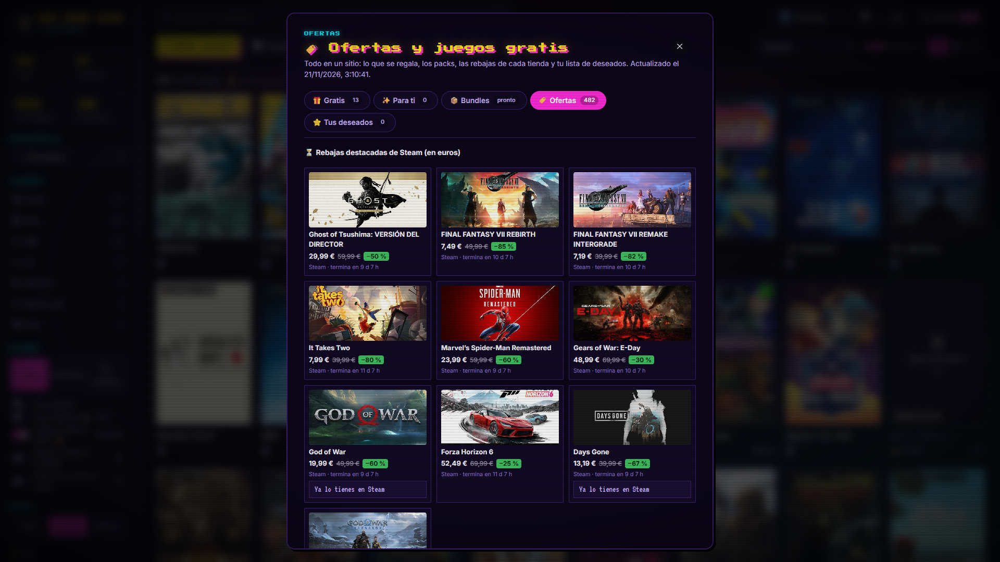
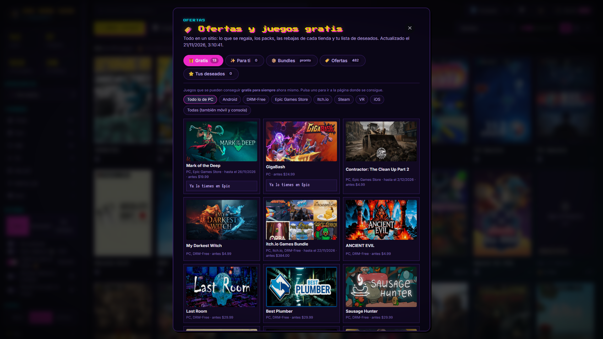

One More Coin no vende juegos ni cobra comisiones: cada oferta te lleva a su tienda. Precios de Steam en euros; los del resto de tiendas, en dólares (vienen de <a href="https://www.cheapshark.com">CheapShark</a>, que solo trabaja en dólares). Juegos gratis gracias a <a href="https://www.gamerpower.com">GamerPower</a>.

## 🎨 Más de 60 estilos para tu biblioteca

Recreativa de neón, escritorios de ventanas de varias épocas, consolas de sobremesa y portátiles, juegos míticos, anime, cine y series, un modo RGB que pasa por todos los colores… Cada estilo trae su propia letra y su propio efecto al pasar el ratón. Cambia el aspecto entero con un clic.

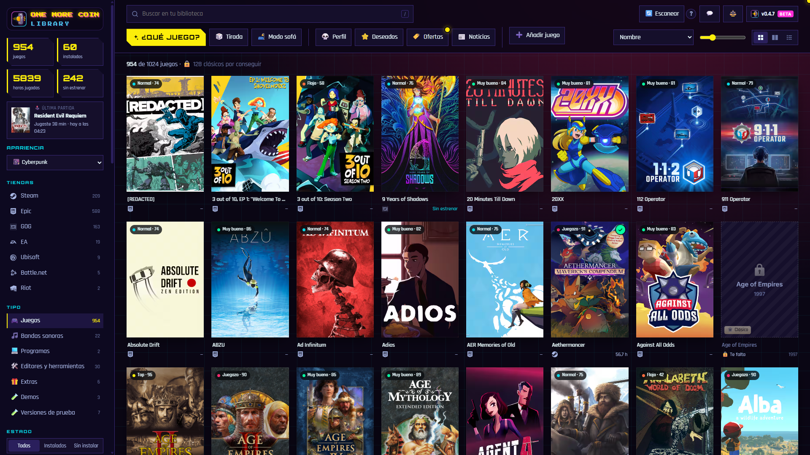
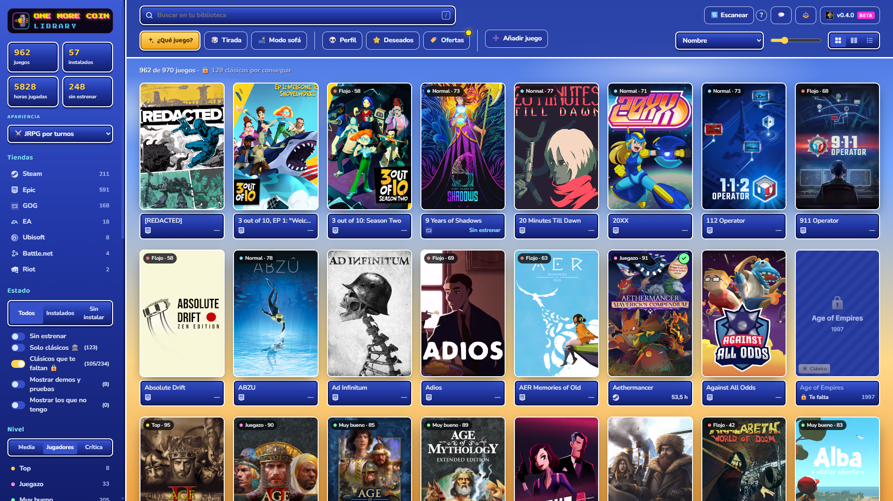
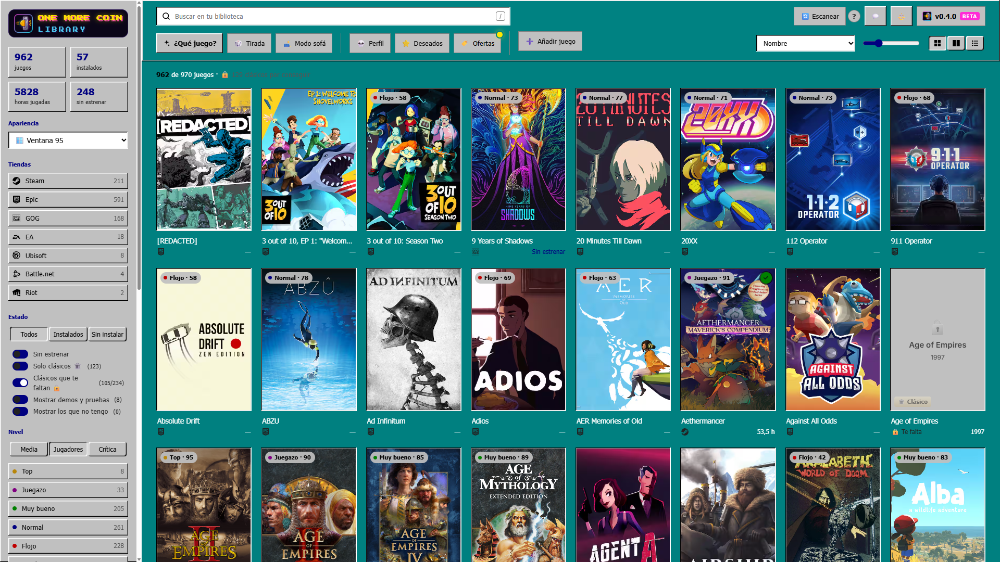
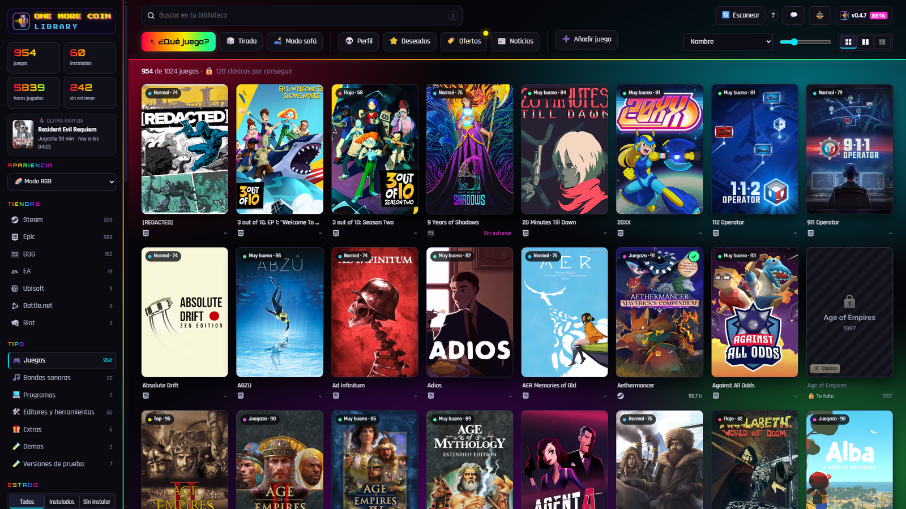
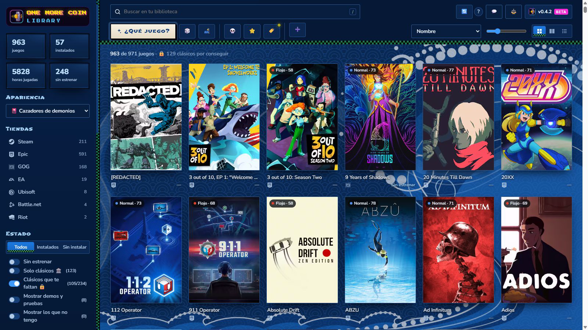
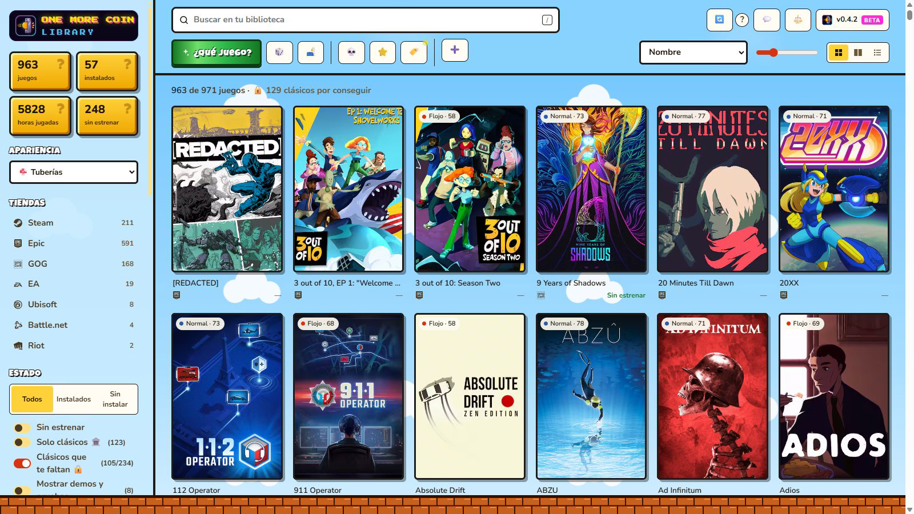

## 🐢 Para cualquier PC

¿Equipo antiguo o portátil justo? Activa el **Modo ligero** (menú 🪙 → Ajustes): quita solo los efectos que más cargan y todo lo demás se queda igual.
El botón **«Analizar mi equipo»** te dice si te conviene. Funciona desde un Intel Core i3 de 1.ª generación con 4 GB de memoria.

## ✨ Y además

| | |
|---|---|
| 🏆 **Logros** de Steam y GOG: cuáles tienes, cuándo y cuáles te faltan | 🏛️ **Colección de clásicos**: más de 230 juegos que hicieron historia, cada uno con su historia (y la de su remake); los que te faltan salen apagados hasta que los consigues |
| 📖 **Fichas completas**: descripción, capturas, vídeos y la insignia **GOTY** de los Juegos del Año | 🗣️ **Qué dice el fandom**: el resumen de lo que opinan jugadores y crítica |
| 🔍 **Filtros de todo tipo**: tienda, género, cooperativo, PvP, sin estrenar, nota… | ✍️ **Tu nivel y tu crítica** para cada juego |
| 🔄 **Se actualiza sola**: tu biblioteca y la propia app | 🐢 **Modo ligero** para PCs antiguos, con **análisis de tu equipo** |
| ➕ **Añade a mano** lo que una tienda no guarde en el PC | 📖 **Guía** de todo lo que hace, y las **novedades** de cada versión dentro de la app |
| 🔔 **Avisos**: juegos gratis y ofertas nuevas, versión nueva, ofertas de tus deseados y deseados que ya tienes | 🧩 **Una sola carta** aunque tengas el juego en varias tiendas |

## 🔒 Tus datos son tuyos

- Tu biblioteca se lee **en tu PC y solo leyendo**: One More Coin **nunca cambia nada** de tus launchers.
- **Sin cuentas, sin publicidad, sin analítica.** Para completar cada juego solo se pregunta su nombre a servicios públicos (tienda de Steam, Wikidata…), sin nada que te identifique.

## 🔑 Claves opcionales: RAWG y SteamGridDB

One More Coin funciona **sin nada más**. Pero si quieres **más notas de jugadores y más portadas** (sobre todo de juegos que no están en
Steam), puedes añadir dos **claves gratuitas** de dos webs muy conocidas entre jugadores. Es opcional y se hace en 2 minutos.

| | 🎮 **RAWG** ([rawg.io](https://rawg.io)) | 🖼️ **SteamGridDB** ([steamgriddb.com](https://www.steamgriddb.com)) |
|---|---|---|
| **Qué es** | Una de las bases de datos de videojuegos más grandes del mundo, con las notas y opiniones de sus jugadores | Una web hecha por la comunidad con portadas, logos y fondos de juegos, muy usada para personalizar las portadas de Steam y de otros programas de biblioteca |
| **Qué te da en One More Coin** | La nota de los jugadores, el año, los géneros y el reparto de opiniones, también de juegos que no están en Steam | Portadas de reserva para los juegos que no tienen portada o la tienen en blanco y negro |
| **Cómo se saca** | En rawg.io/apidocs → «Get API key», con una cuenta gratis | En steamgriddb.com, entrando con tu cuenta de Steam → Perfil → Preferencias → API |

**¿Qué es una «clave»?** Un código que te da cada web para que una app le pueda **pedir datos de juegos** (es como un pase de
biblioteca). **No es tu contraseña** y no da acceso a tu cuenta ni a nada tuyo: solo sirve para consultar información pública de juegos.

**¿Es seguro?**
- ✅ Las dos son **gratis** y no piden tarjeta ni pagos.
- ✅ La clave se guarda **cifrada en tu PC** y cada una **solo se envía a su propia web**: One More Coin no la manda a nadie más.
- ✅ La puedes **quitar** cuando quieras (menú 🪙 → Ajustes) y también borrarla o cambiarla en la propia web.
- ✅ En SteamGridDB, el inicio de sesión se hace **en la web oficial de Steam**: SteamGridDB no ve tu contraseña.
- ℹ️ La cuenta la creas **con ellas**, no con One More Coin, y se rige por sus propias condiciones; One More Coin nunca ve tu correo ni tu cuenta.

**¿Y por qué una clave tuya y no una de la app?** Estas webs dan a cada persona un número limitado de consultas. Si la app llevara una
sola clave para todos, entre todos se gastaría el límite en un día; con la tuya, el límite es solo tuyo.

Dónde se ponen: **menú 🪙 → Ajustes → «Claves para más datos»**, con los pasos explicados uno a uno y un botón que comprueba que funciona.

## 💻 Requisitos

### 🪟 Windows

| | Mínimos | Recomendados |
|---|---|---|
| **Sistema** | Windows 10 (64 bits) | Windows 10 u 11 (64 bits) |
| **Procesador** | 2 núcleos (de 2010 en adelante, p. ej. Intel Core i3 de 1.ª generación) | 4 núcleos o más |
| **Memoria** | 4 GB | 8 GB |
| **Disco** | 500 MB libres | 500 MB libres en un SSD |
| **Pantalla** | 1280 × 720 | 1920 × 1080 |
| **Internet** | Para completar los datos de los juegos y buscar ofertas | Lo mismo |

### 🐧 Linux (versión de prueba)

| | Mínimos | Recomendados |
|---|---|---|
| **Sistema** | 64 bits (x86-64): Ubuntu 22.04, Linux Mint 21, Debian 12, Fedora 38 o similares | Ubuntu 24.04 o equivalente reciente |
| **Procesador** | 2 núcleos (de 2010 en adelante) | 4 núcleos o más |
| **Memoria** | 4 GB | 8 GB |
| **Disco** | 500 MB libres | 500 MB libres en un SSD |
| **Pantalla** | 1280 × 720 | 1920 × 1080 |
| **Para leer tu biblioteca** | Steam, Heroic (Epic, GOG y Amazon), Lutris o itch.io. Lo que no es Steam está en pruebas | Lo mismo |

### 🍎 Mac (versión de prueba)

| | Mínimos | Recomendados |
|---|---|---|
| **Sistema** | macOS 12 Monterey | macOS 14 Sonoma o más nuevo |
| **Procesador** | Chip de Apple (M1 o posterior). Los Mac con procesador Intel no son compatibles | M2 o posterior |
| **Memoria** | 8 GB | 8 GB o más |
| **Disco** | 500 MB libres | 500 MB libres |
| **Pantalla** | 1280 × 800 | La del propio Mac |
| **Para leer tu biblioteca** | Steam, GOG Galaxy, Epic, Battle.net, itch.io o Heroic. Lo que no es Steam está en pruebas | Lo mismo |

> En equipos justos, activa el **Modo ligero** (menú 🪙 → Ajustes); el botón **«Analizar mi equipo»** te dice si te conviene.
> En todos los sistemas hace falta **internet** para completar los datos de los juegos y buscar ofertas.

## ⬇️ Descargar

Ve a **[la última versión](../../releases/latest)** y descarga la de tu sistema:

| Sistema | Archivo | |
|---|---|---|
| 🪟 **Windows 10 / 11** (64 bits) | `One-More-Coin-Instalador-X.Y.Z.exe` | ✅ Recomendada |
| 🐧 Linux | `One-More-Coin-X.Y.Z-Linux.AppImage` | 🧪 Prueba (lee Steam, Heroic, Lutris e itch.io) |
| 🍎 Mac (chip Apple) | `One-More-Coin-X.Y.Z-Mac.dmg` | 🧪 Prueba (lee Steam, GOG Galaxy, Epic, Battle.net, itch.io y Heroic) |

> [!NOTE]
> **¿Sale «Windows protegió su PC»?** Es normal: la app no tiene un certificado de firma (cuesta dinero cada año y esto es un proyecto personal y gratuito), no porque tenga nada malo. Pulsa **«Más información» → «Ejecutar de todos modos»**.

Instrucciones completas (también Linux y Mac) en el **[LEEME](LEEME.txt)** · Qué trae cada versión en **[NOVEDADES](NOVEDADES.md)**.

## ❓ Preguntas frecuentes

<b>🔑 ¿Cómo sabe One More Coin qué juegos tengo? ¿Necesita mi usuario y contraseña?</b>

No, nunca. Cada launcher (Steam, Epic, GOG, EA…) guarda en tu PC, para su propio uso, una lista de los juegos que tienes: cuáles están instalados, cuántas horas llevas o cuándo jugaste por última vez. One More Coin solo **lee esa lista**, como quien lee los títulos de los libros de una estantería sin necesitar la llave de la librería donde los compró.

En esa lista no están tu usuario, tu contraseña, tu correo, tus métodos de pago ni tus mensajes, y One More Coin tampoco los busca. Por eso no tiene pantalla para iniciar sesión: no hay nada que poner.

<b>▶️ Cuando pulso «Jugar» o «Instalar», ¿entra en mi cuenta del launcher?</b>

No. El botón funciona como un acceso directo del escritorio: le dice a tu launcher «abre este juego», usando el mismo enlace oficial que usa el propio launcher. A partir de ahí todo lo hace él, con la sesión que ya tienes abierta: comprueba que el juego es tuyo, lo arranca, cuenta tus horas y guarda tus partidas.

Si el launcher te pide iniciar sesión, la contraseña se escribe **en el launcher**, nunca en One More Coin. Y si es para instalar, la ventana de instalación es la del launcher, y eres tú quien la confirma.

<b>🚫 ¿Qué no puede hacer One More Coin con mis cuentas?</b>

Nada, porque no entra en ellas. No puede comprar, ni cambiar tu contraseña o tus datos, ni ver a tus amigos, tus mensajes o tu tarjeta, ni hablar en tu nombre. Tampoco modifica tus launchers ni tus juegos: solo lee.

⚠️ Si alguna vez algo que dice ser One More Coin te pide la contraseña de Steam, de Epic o de cualquier otra tienda, **no es One More Coin**: no la des.

<b>🕹️ ¿Cómo sabe a qué estoy jugando ahora?</b>

Mira qué programas tienes abiertos en tu PC, lo mismo que ves en el Administrador de tareas de Windows. Si uno está dentro de la carpeta de un juego tuyo, ese es el que estás jugando. Solo mira el nombre del programa y la hora a la que lo abriste. No se mete en el juego, no lee lo que pasa dentro y no envía nada a nadie: todo se queda en tu PC.

<b>🔍 ¿Cómo puedo comprobar que no entra en mis cuentas?</b>

Desconecta internet y abre One More Coin: tu biblioteca, tus horas y tus juegos instalados siguen ahí, igual. Si la app tuviera que entrar en tus cuentas para saber qué tienes, sin internet no podría. Y verás que en ningún momento te ha pedido ni usuario ni contraseña.

<b>🔌 ¿Tengo que tener los launchers abiertos o con la sesión iniciada?</b>

Para ver tu biblioteca, no: One More Coin lee la lista que cada launcher dejó en tu PC la última vez que lo usaste, aunque ahora esté cerrado. Solo para jugar o instalar hace falta el launcher, y es él mismo el que se abre cuando pulsas el botón. Si un juego que acabas de comprar no aparece, abre su launcher una vez para que actualice su lista.

<b>📤 ¿Qué sale de mi PC?</b>

Solo lo necesario para completar la ficha de cada juego: su **nombre o su número en la tienda**, que se pregunta a servicios públicos (la tienda de Steam, GOG, Wikidata…) para traer la portada, el año, la nota de los jugadores o los extras que trae. Nunca se envía tu lista completa ni nada que diga quién eres, ni tus horas, ni tus cuentas. Para las noticias, a cada portal solo se le pide su lista pública de noticias. Lo único más es lo que tú escribas en «💬 Sugerencias», que llega sin tu nombre ni tu correo.

<b>¿Qué gano yo usando One More Coin?</b>

Ver **todos tus juegos juntos** sin abrir seis tiendas, no volver a comprar algo que **ya tenías** en otra, redescubrir lo que compraste y **nunca estrenaste**, tener los juegos gratis y las ofertas en un solo sitio, y que el dado o el test te ayuden a decidir a qué jugar.

<b>¿Es gratis?</b>

Sí. Es una **beta**: una versión de prueba, gratis, que puede tener algún fallo. Si ves uno, cuéntalo desde el botón «💬 Sugerencias» de la app.

<b>¿Puede darme problemas con los antitrampas (Vanguard, Easy Anti-Cheat…)?</b>

No debería: One More Coin **no se mete en los juegos**. No lee su memoria, no pone nada encima de la pantalla del juego y no instala controladores. Solo lee los archivos donde las tiendas apuntan qué tienes y, para jugar, se lo pide a la tienda oficial, igual que otros programas de biblioteca conocidos.

<b>¿Puede romper algo de mis tiendas o de mis juegos?</b>

No. Solo **lee** sus archivos, nunca los cambia. Y para jugar o instalar, se lo pide a la propia tienda con sus enlaces oficiales.

<b>¿Cómo me recomienda juegos? ¿Me espía?</b>

No. En «🏷️ Ofertas → ✨ Para ti», One More Coin mira **en tu PC** tus horas de juego y los juegos que ya tienes: te propone los de las **sagas que juegas** que aún te faltan y ofertas de los **géneros a los que más horas dedicas**. Tu biblioteca y tus horas no salen de tu PC: solo pregunta a Wikidata, por su código, de qué saga o género es cada juego.

<b>¿Qué son las claves de RAWG y SteamGridDB? ¿Son seguras?</b>

Son **opcionales y gratis**: sirven para tener más notas de jugadores (RAWG) y más portadas (SteamGridDB). Una clave **no es tu contraseña** ni da acceso a tu cuenta; se guarda **cifrada en tu PC** y solo se envía a su propia web. Todo explicado en [Claves opcionales](#-claves-opcionales-rawg-y-steamgriddb).

<b>¿Ralentiza mis juegos?</b>

Mientras está abierta, revisa tu biblioteca al arrancar y cada hora, en segundo plano. Para jugar **no hace falta tenerla abierta**: si quieres el PC al 100 %, ciérrala. En equipos justos, activa el **Modo ligero** (menú 🪙 → Ajustes).

<b>¿Funciona sin internet?</b>

Sí: tu biblioteca, tus horas y todo lo ya descargado se ven sin conexión. Internet hace falta para completar juegos nuevos, buscar ofertas y actualizarse.

<b>¿Por qué falta algún juego o no salen sus horas?</b>

Algunas tiendas no guardan en el PC todo lo que tienes comprado (Epic, Battle.net o Xbox, por ejemplo) y otras no guardan las horas (Epic). Los que falten se pueden **añadir a mano** y los que sobren, **ocultar**.

<b>¿Funciona en un PC antiguo?</b>

Sí, desde un **Intel Core i3 de 1.ª generación con 4 GB** de memoria, con **Windows 10 u 11 de 64 bits** (mira los requisitos). En equipos modestos activa el **Modo ligero** (menú 🪙 → Ajustes): quita solo los efectos que más cargan. El botón «Analizar mi equipo» te dice si te conviene; en PCs muy justos se activa solo.

<b>¿Dónde se guardan mis cosas y qué pasa si la desinstalo?</b>

Tus niveles, críticas, deseados y ajustes se guardan solo en tu PC. Si la desinstalas, se quedan guardados por si vuelves; para borrarlos del todo, elimina la carpeta `%APPDATA%\One More Coin`.

<b>¿Cómo se actualiza?</b>

Sola: te avisa cuando hay versión nueva (punto amarillo en el botón 🪙) y la instalas con un clic. Tu biblioteca y tus ajustes se quedan como están.

<b>¿Lleva virus, publicidad o algo raro?</b>

No. No tiene publicidad, no instala nada más y no necesita permisos de administrador para funcionar. Si Windows avisa al instalarlo es solo porque aún no tiene certificado de firma (mira «¿Es de fiar?», arriba).

<b>¿Quién lo ha hecho?</b>

**JesusJacky**, como proyecto personal, por pura pereza de abrir seis tiendas para saber qué juegos tiene 😅. Puedes escribirle a **jesusjacky.onemorecoin@gmail.com** o desde «💬 Sugerencias» en la app.

---

Aquí están los **instaladores** y la información pública de One More Coin; el código de la aplicación no es público. 
One More Coin es gratis y se ofrece «tal cual». Las marcas, portadas y textos de los juegos y las tiendas son de sus dueños; One More Coin no está afiliada a ninguna.

**Un proyecto personal de JesusJacky** · © 2026 JesusJacky. Todos los derechos reservados ([LICENCIA](LICENSE)) · 🪙 *Inserta una moneda para continuar…*

